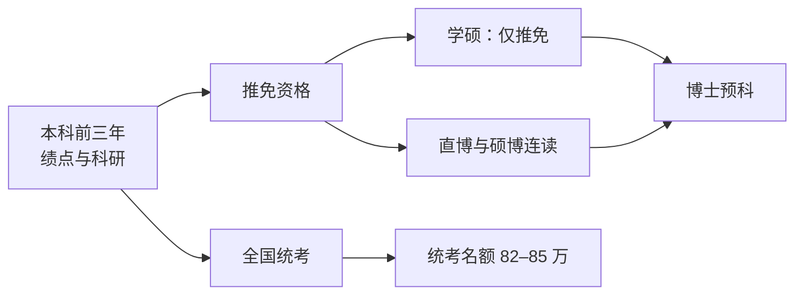
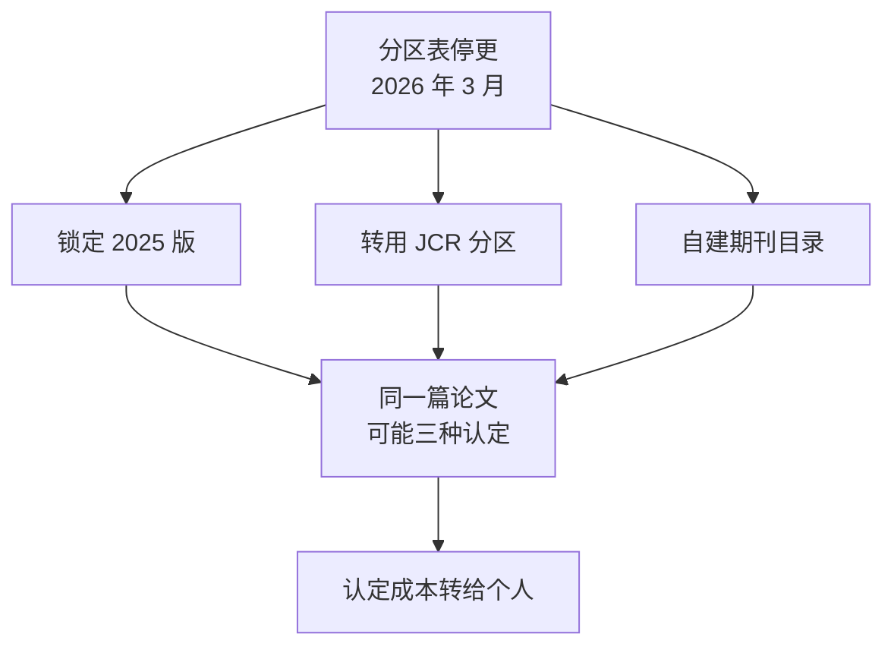

## 〇、两个数字

先看两个数。

教育部公布的考研报名人数：2022 年 457 万，2023 年 474 万见顶，2024 年 438 万，2025 年 388 万，2026 年 343 万。三年少了 131 万，降幅 27.6%，规模退回 2020 年前后。机构对 2027 年的预测集中在 320 万到 335 万之间。

另一边，2026 年研究生招生总规模约 137 万到 142 万，其中推免生约占四成，留给统考的名额只有 82 万到 85 万。

第一个数在跌，第二个数没涨。于是出现了一个反直觉的结论：**人少了，但统考这条路没有变宽。**

通常的解释是"竞争更激烈了"。这个说法对，但太粗——它只描述强度，不解释结构。真正发生的事情要具体得多：过去二十年，这套筛选机制没有变严，它把成本**搬走**了。

从机构搬给个人，从一次性搬给长期，从公开规则搬给私人信息。每一次搬家都被包装成改革的名字：扩大推免、分类培养、破五唯、优化结构。方向却始终一致。

这篇要做的，是把五次搬家一次一次摊开，然后回答一个问题：它们合起来，拿走了什么。

## 一、命题：不是变难，是搬家

先说清楚"搬家"是什么意思。

任何一次筛选都有成本：谁准备、谁等待、谁承担失败、谁负责核实。这些成本原来放在哪里、现在被挪到哪里，是可以逐项对照的。对照下来，五个方向非常整齐：

<figure>
<svg viewBox="0 0 680 244" width="100%" role="img" aria-label="筛选成本的五个转移方向">
<title>成本从制度一侧搬向个体一侧的五条通道</title>
<defs>
<marker id="a1" viewBox="0 0 10 10" refX="8" refY="5" markerWidth="6" markerHeight="6" orient="auto-start-reverse">
<path d="M2 1L8 5L2 9" fill="none" stroke="context-stroke" stroke-width="1.5" stroke-linecap="round" stroke-linejoin="round"/>
</marker>
</defs>
<rect x="40" y="56" width="140" height="168" rx="10" fill="#0C447C" stroke="#85B7EB" stroke-width="0.5"/>
<text x="110" y="128" font-size="14" font-weight="500" fill="#E6F1FB" text-anchor="middle">制度</text>
<text x="110" y="150" font-size="12" fill="#85B7EB" text-anchor="middle">筛选的发起方</text>
<rect x="500" y="56" width="140" height="168" rx="10" fill="#633806" stroke="#FAC775" stroke-width="0.5"/>
<text x="570" y="128" font-size="14" font-weight="500" fill="#FAEEDA" text-anchor="middle">个体</text>
<text x="570" y="150" font-size="12" fill="#FAC775" text-anchor="middle">成本的承接方</text>
<line x1="192" y1="84" x2="486" y2="84" stroke="#85B7EB" stroke-width="1.5" marker-end="url(#a1)"/>
<text x="339" y="76" font-size="12" fill="currentColor" text-anchor="middle">一 · 往前：时间</text>
<line x1="192" y1="116" x2="486" y2="116" stroke="#85B7EB" stroke-width="1.5" marker-end="url(#a1)"/>
<text x="339" y="108" font-size="12" fill="currentColor" text-anchor="middle">二 · 往细：颗粒度</text>
<line x1="192" y1="148" x2="486" y2="148" stroke="#85B7EB" stroke-width="1.5" marker-end="url(#a1)"/>
<text x="339" y="140" font-size="12" fill="currentColor" text-anchor="middle">三 · 往私：定价权</text>
<line x1="192" y1="180" x2="486" y2="180" stroke="#85B7EB" stroke-width="1.5" marker-end="url(#a1)"/>
<text x="339" y="172" font-size="12" fill="currentColor" text-anchor="middle">四 · 往内：层级</text>
<line x1="192" y1="212" x2="486" y2="212" stroke="#85B7EB" stroke-width="1.5" marker-end="url(#a1)"/>
<text x="339" y="204" font-size="12" fill="currentColor" text-anchor="middle">五 · 往下：证据</text>
</svg>
<figcaption>五条通道不是并列的，是同一笔成本被反复拆分的结果。</figcaption>
</figure>

为什么用"搬家"而不是"内卷"？因为内卷只说明大家更用力，搬家能说明用力用在了哪里、为什么必须提前、为什么越来越多人觉得"努力和结果对不上"——那不是错觉，是账目换了记账人。

判断一次变化是不是搬家，看三件事：**谁承担成本、什么时候承担、以什么形式承担。** 三个都变了，就是搬家；只变了一个，那叫涨价。

下面五次，每次都按这三件事对账。

## 二、第一次搬家：往前

从"考试那天"搬到了"大一的第一门课"。

推免（保研）本来是少数人的通道。现在它成了主通道的一部分：2026 年研究生招生里推免约占四成，统考名额只剩 82 万到 85 万。推免比例有一道公开的天花板——各招生单位接收推免生不得超过本单位硕士招生总规模的 50%——但这是**全校口径**。具体到院系和专业，这道线可以越过去：热门 985 的学硕推免占比普遍在 50% 到 60%，据行业报告，部分双一流文科专业接近全部推免。

顶尖高校走得更远。清华大学 2026 届推免拟录取 3783 人，比上一届多 106 人；其中直博生约两千人——两个统计口径分别给出 1997 人（52.79%）与 2010 人（54.3%），都指向同一个事实：**直博已经是主体，硕士成了少数。** 清华本届保研率约 76%，北大校本部 69.47%，北大医学部 72.01%，国科大 72.47%，复旦 50.22%。

生源结构更值得看：清华推免生里本校约占 40%，外校 54%，211 高校只占 4%，双非不足 1.43%；工科院系的本校生源占比甚至能到 80%。**通道没有关闭，是换了入口。**

学硕的收缩要分三种形态说，混在一起说会失真：

- **缩招**：这是整体趋势，学硕名额在减，统考名额被推免挤压。
- **仅推免**：部分专业保留学硕，但不再接受统考。南京大学新闻传播学院的新闻学方向，2027 年起只招推免。
- **停招**：这是少数学院的选择，有公告可查——复旦大学数学科学学院 2027 年起不再招收学术学位硕士（专项计划除外），上海交通大学数学学院同年停招，浙江大学十余个学院 2027 年仅招全日制专业学位硕士。

三者的量级完全不同。停招是个别学院的入口关闭，缩招才是全局。

但方向是同一个：**筛选从"那一天"提前到了"那三年"。** 以前你需要在一次考试里赢；现在你需要在三年里不出错——绩点、竞赛、进组、论文，一项掉队就出局。

成本就这样搬了：准备期从一年变成三年，承担者从考生变成大一大二的学生，形式从"集中冲刺"变成"持续积累"。而这三年的投入，是没有保底的——推免没拿到，你还是得回去考。

## 三、第二次搬家：往细

从"是不是研究生"，搬到了"哪个学校、哪个学院、哪个方向、哪个导师"。

专硕的扩张是最直观的证据：2021 年专硕占硕士招生约 58%，2026 年到了 69.7%。扩招集中在电子信息、人工智能、集成电路、生物与医药这些方向。总量在涨，但涨的部分高度集中在特定赛道；文科经管类的专硕，内部照样卷。

学历的颗粒度也变了。以前"硕士"是一个档位，现在它至少分成四种定价：卡门槛型（考公、落户、国企，文凭本身是入场券）、产业型（看项目与实习）、科研型（看论文与直博）、顶尖项目型（看导师与平台）。这不是道德分类，是四个不同的市场。

**颗粒度一细，信息成本就上来了。** 同样是 400 分，在 A 学院是稳进，在 B 学院是压线，在 C 方向连面试都进不去。以前查一条国家线就够，现在要查目标学院的推免占比、统考名额、是否只招推免、导师今年有没有名额。

这些信息不公开的部分，就成了新的护城河。9-16 那篇写过一句话：学历是门票，不是估值。现在补一句：**门票还分不同的门，而门的钥匙不发公告。**

## 四、第三次搬家：往私

一把尺子退场，很多把尺子上场。

2026 年 3 月 27 日，中国科学院文献情报中心宣布自 2026 年起不再更新发布期刊分区表；9 月 30 日，在线平台与 API 服务正式关停。这套尺子跑了 22 年，从 2004 年开始，是国内高校评价论文最通用的硬标尺。

停更的理由是"破除唯论文"。但接下来发生的事情更值得看：各校没有统一方案，而是分成了三派。

- **锁定最后一版**：菏泽学院对 2026 年发表的论文采用"向前就近"原则，统一按 2025 版认定；电子科技大学按发表时段分段适用；江西师范大学明确 SCIE、SSCI、AHCI 论文按 2025 版大类学科数据认定，不得自行参照其他版本。
- **转向 JCR**：湖北经济学院 9 月 23 日发布办法，英文论文改用 JCR 分区，同时设过渡期——按投稿时间可走旧目录（需提交载有中科院分区信息的盖章检索报告），按出刊时间走新办法；同一篇论文只能选一套，不得重复计算科研积分。
- **自建目录**：西南交通大学 2026 年职称评聘明确，论文级别总体按学校自己的学术期刊分级目录认定。

连检索报告都跟着变：西交利物浦大学知识产权信息服务中心通知，自 2026 年 10 月 1 日起不再出具任何包含中科院分区数据的收录引用报告。

而新的尺子已经在造了——中国科学技术信息研究所联合相关机构推出自主期刊目录，收录 6132 种期刊，覆盖 55 个国家和地区。

三派并存意味着什么？**同一篇论文，在三个地方可能是三种等级。** 以前你只需要知道"这本刊是几区"，现在你还需要知道：这篇论文投在哪一年、发在哪一年、用来评什么、在哪个单位评、那个单位今年认哪套目录。

这不是评价变松了，是认定的成本从机构搬到了个人。9-24 那篇讲过古德哈特：指标一旦成为目标就会失效。现在补一个后续——**指标消失，激励不会消失，它只是换成了更多套更小的指标。**

## 五、第四次搬家：往内

成本搬进组织内部，然后逐层往下沉。

一个导师面对的不是一个学生，是一张需求矩阵：大一要打竞赛，大二要打竞赛，大三要比赛、要毕设、要实习，大四要就业、要毕设；研一要比赛、要项目，研二要比赛、要项目、要毕设，研三要项目、要就业、要毕业。四五十人的课题组，在这套矩阵里是常态。

管理半径是有物理极限的。一个人管不过来四五十人，就只能分包。

<figure>
<svg viewBox="0 0 680 272" width="100%" role="img" aria-label="课题组内部成本的逐级下沉">
<title>导师到本科生的四级分包与成本下沉</title>
<defs>
<marker id="a2" viewBox="0 0 10 10" refX="8" refY="5" markerWidth="6" markerHeight="6" orient="auto-start-reverse">
<path d="M2 1L8 5L2 9" fill="none" stroke="context-stroke" stroke-width="1.5" stroke-linecap="round" stroke-linejoin="round"/>
</marker>
</defs>
<rect x="40" y="48" width="320" height="40" rx="8" fill="#0C447C" stroke="#85B7EB" stroke-width="0.5"/>
<text x="200" y="68" font-size="13" fill="#E6F1FB" text-anchor="middle" dominant-baseline="central">导师 · 一人对四五十人</text>
<text x="378" y="68" font-size="12" fill="currentColor" dominant-baseline="central">拉项目、定方向、签字</text>
<line x1="200" y1="88" x2="200" y2="104" stroke="#85B7EB" stroke-width="1.5" marker-end="url(#a2)"/>
<rect x="70" y="104" width="260" height="40" rx="8" fill="#185FA5" stroke="#85B7EB" stroke-width="0.5"/>
<text x="200" y="124" font-size="13" fill="#E6F1FB" text-anchor="middle" dominant-baseline="central">博士 · 中层工头</text>
<text x="378" y="124" font-size="12" fill="currentColor" dominant-baseline="central">带人、补漏、盯进度</text>
<line x1="200" y1="144" x2="200" y2="160" stroke="#85B7EB" stroke-width="1.5" marker-end="url(#a2)"/>
<rect x="100" y="160" width="200" height="40" rx="8" fill="#378ADD" stroke="#B5D4F4" stroke-width="0.5"/>
<text x="200" y="180" font-size="13" fill="#042C53" text-anchor="middle" dominant-baseline="central">硕士 · 熟练工</text>
<text x="378" y="180" font-size="12" fill="currentColor" dominant-baseline="central">做实验、跑数据、写初稿</text>
<line x1="200" y1="200" x2="200" y2="216" stroke="#85B7EB" stroke-width="1.5" marker-end="url(#a2)"/>
<rect x="130" y="216" width="140" height="40" rx="8" fill="#85B7EB" stroke="#E6F1FB" stroke-width="0.5"/>
<text x="200" y="236" font-size="13" fill="#042C53" text-anchor="middle" dominant-baseline="central">本科 · 末端</text>
<text x="378" y="236" font-size="12" fill="currentColor" dominant-baseline="central">打比赛、做毕设、跑腿</text>
</svg>
<figcaption>每一层都往下转一次，转到最底层时，成本已经看不见发起人。</figcaption>
</figure>

这也是"让本科生变回本科生"注定落不了地的地方。

这句口号本身是对的：本科生该上课、该读书，而不是大一就进组打竞赛。但它的现实阻力不在观念，在结构——**本科生科研本身就是这条转移链的末端劳动力池。** 取消它，等于抽掉链条的一条腿：竞赛谁打、数据谁跑、基础实验谁做？

10-07 那篇写过这个金字塔的形状：平均生师比 4.87 与 3.53，个体四五十人的分布。这一篇要说的是另一件事——**它不是效率问题，是成本问题。** 只要上层还背着指标，下层就必须留着一个池子承接；口号可以喊，链条不能断。

顺带说一句更冷的：链条最下面那层，往往是最容易被忽略的。本科生的毕设、专科生的实习、外校生的"帮忙"，都在这条链的末端。他们不出现在基金结题报告里，但他们的时间构成了报告的底座。

## 六、第五次搬家：往下

最后一层，搬到了个人身上：证明自己。

过去证明一个人能干，主要靠三种凭证：学历、单位、上级。三种都有共同点——**由机构签发，也由机构背书。** 你不需要自证，证书替你说话。

现在这三种凭证都在贬值。学历溢价在收窄（10-06 那篇算过），单位的终身制在退出，上级的推荐信在算法面前不值钱。于是出现了一个新要求：**你得自己拿出证据。**

证据的形态很具体：一段完整闭环的项目、一个讲得深的仓库、一份能被别人重跑的评测、一次真实交付的复盘。10-03 那篇把它拆成两类——单兵靠闭环作品，团队靠别人在你作品上的留痕。9-25 那篇说得更直接：作品集是进入第二轮验证的门票，不是通行证。

听起来是好事：能力本位，比学历本位公平。但它同时是一次搬家——**认证的成本，从机构转移到了个人。**

机构认证是批量的：一张毕业证，学校替你盖一次章，之后所有人共用。个人认证是个体的：每换一次工作、每进一个新领域，你都得重新攒一遍证据。而且攒的过程没有保底——你做的项目可能涉密、可能被公司锁在内部、可能因为保密协议拿不出来。

企业端的动作也在配合这次搬家：实习从"加分项"变成"第一道关卡"。智联 2024 年的调研里，毕业生认为求职成功归因第一位的是"相关实习经历"（38.9%），高于学历、专业和证书。这不是企业变挑剔了，是它们在用"你已经做过什么"替代"我们愿意培养你做什么"——培养成本也被搬走了。

## 七、搬不动的：验证

到这里，五次搬家已经很清楚：时间、颗粒度、定价权、层级、证据，全都在往个人这边移。

但有一件事搬不动：**验证。**

10-18 那篇《越标准越便宜》算过一笔账：Flash 一类的模型把标准工程的成本压到了每任务一元多，77 分的活儿只要一块多钱。产出便宜到这个程度，接下来的瓶颈就不在"做"，在"验"。

DORA 2025 年的数据给了同一件事的行业刻度：90% 的 AI 采用率下，bug 增加 9%，代码审查时间延长 91%，PR 规模增大 154%。生成便宜了，评审没有便宜。

这两件事放在一起，就是这次搬家的天花板：**能被转移的是成本，转不走的是后果。**

你可以让别人替你写、替你查、替你整理，但没人能替你签字。10-14 那篇写过验证设计：验证足够残酷时，信任可以后付；验证不够残酷时，再多解释也没用。这句话对论文、对代码、对简历都成立。

所以"可验证的交付"不是这一轮的解药，它是这一轮的账单：系统把认证成本转给了你，你只能用更硬的证据把它顶回去。顶得回去的人，拿到了定价权；顶不回去的人，只剩下解释权。

## 八、结算：犬儒主义

讲到这里，情绪那部分就可以解释了。

犬儒主义有两个版本，含义几乎相反。古典版本是"野狗"：第欧根尼住在木桶里，对亚历山大大帝说"请你不要挡住我的阳光"。它用一种极端的生活方式去冲撞虚伪的习俗，是积极的抗争。现代版本是"家犬"：看穿了一切，却选择趴在院子里，对着门外叫两声，然后继续接受投喂。

今天说的犬儒，几乎都是后者。它的定义可以写得很短：**看穿，但不行动。**

这不是道德缺陷。把它放到前面五次搬家之后，它更像一个理性的结算结果：当规则越来越细、越来越不透明、越来越由具体单位决定，个体能做的只剩下两件事——搞清楚自己单位的规则，以及在搞不清楚的时候先保住位置。

方可成批评过一种说法：大学的意义不是教育，只是筛选。他把这种说法叫作犬儒主义——它看穿了教育理想在现实中的无力，然后放弃了追问"大学为何而教"，只承认它作为筛选机器的工具价值。这个批评之所以成立，是因为它描述的不是学生的懒惰，而是**一种清醒的放弃**。

而"清醒的放弃"是有土壤的。当努力与回报的关联变得模糊，最省力的姿态就是：我知道这套东西有问题，但我不打算改变它，我只打算在里面活得舒服一点。学生的"深度疲态"、课堂上的"应付心态"，都是这个姿态的表情。

10-06 那篇写过"向往的死亡"：向往型品牌成批死亡，因为"努力就能出人头地"的社会契约在退场。向往死了之后，留下的姿态就是犬儒——不是不信，是信了也没用，所以干脆不信。

这里要留一句对冲：犬儒最危险的地方，不是它让人消极，是它完成了最后一次搬家——**把解释的成本也转给了个人。** 当你把结构问题翻译成"大家都这样""人各有命""想开点"，你就替系统把账结了。这不是你的错，但账确实被结掉了。

## 九、收束：被搬走的可规划性

把五次搬家并排放，会看到一件很有意思的事：它们拿走的不是机会，是**可规划性**。

可规划性的意思是：你知道规则是什么、知道什么时候该做什么、知道投入大概会换来什么。它有三根支柱——规则公开、时间可预期、回报有相关性。

五次搬家，一根一根拆：

- 往前搬，拆掉了"时间可预期"：你不能再等到大三再决定，因为大一的绩点已经计入。
- 往细搬，拆掉了"规则公开"：同一个分数、同一篇论文，在不同学院、不同单位是不同价格。
- 往私搬，拆掉了"规则统一"：认定权下放，你得自己盯着目标单位今年认哪套目录。
- 往内搬，拆掉了"回报相关"：你的产出和你的收益之间，隔着一层又一层的分包。
- 往下搬，拆掉了"凭证可信"：机构不再替你背书，你得自己攒证据。

可规划性不是个人能力，它是公共品。公共品的特点是：所有人都在用，但没人愿意出钱维护；一旦被拆掉，个人再怎么努力也补不回来——你没法靠自律重建一套公开的规则。

所以对个体来说，真正的问题不是"更难了"。难是可以靠努力对冲的。真正的问题是：**你被要求在不知道规则的情况下，提前很久下注。**

这才是这五次搬家最终的账单。它没有寄给某一个人，它寄给了所有人。

## 附：口径

- 报名人数（2022–2026）、2027 年预测、专硕占比、往届生占比：教育部序列与机构预测/报告，媒体转述一致；2027 年数字为预测，非官方公布。
- 招生总规模 137–142 万、推免约四成、统考 82–85 万：行业报告口径（三个皮匠《2026 年研究生招生调查报告》），非官方发布。
- 清华 2026 届推免 3783 人、直博 1997 人（52.79%）与 2010 人（54.3%）：据清华研究生院及院系公示名单统计，两个口径并存，文中按"约两千人、过半"处理；保研率与生源结构为同一批统计的推算值。
- 北大、国科大、复旦保研率：据各校公示名单统计的二手数据。
- 学硕停招：复旦数学、上交数学、浙大十余个学院、南大新闻学，均有一手公告或官媒报道；其余为缩招与仅推免，不作"停招"表述。
- 中科院分区：2026-03-27 文献情报中心宣布停更，9 月 30 日平台与 API 关停；三派接盘方案分别引自菏泽学院、电子科技大学、江西师范大学、湖北经济学院、西南交通大学公开通知；西交利物浦大学检索报告调整引自其服务中心通知；中信所目录为公开报道。
- 智联 2024 就业力调研（相关实习经历 38.9%）、DORA 2025（bug +9%、评审 +91%、PR +154%）、10-18 那篇《越标准越便宜》的 Flash 数据，口径与原文一致。
- 课题组生师比 4.87 与 3.53 沿用 10-07 那篇的统计口径。
