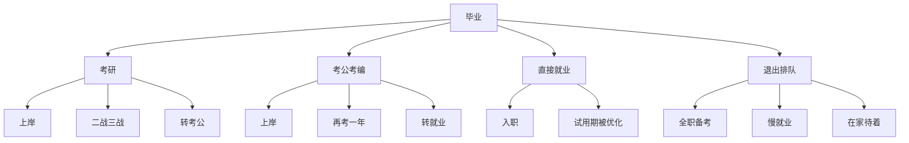

## 〇、两个公告，一个方向

十月是排队的日子。

10 月 13 日，2027 年度国考公告发布：计划招录 3.57 万人，比上一年度的 3.81 万少 2400 人，降幅 6.3%。这已经是连续第二年缩招——2026 年那次是近年来首次下降，减了 1600 人。报名从 10 月 15 日开始，笔试定在 11 月 29 日。

同一周，2027 年考研的正式报名也在进行（10 月 15 日到 24 日），初试在 12 月 19 日到 20 日。上一届的数字是 343 万，比 2023 年的峰值 474 万少了 131 万，连降三年。

两个公告，一升一降的叙事都对不上：考研人数在降，考公的岗位在减，而青年失业率还在高位——2026 年 7 月，全国城镇不含在校生的 16 至 24 岁劳动力失业率是 17.9%，比 6 月上升 3 个百分点。

把这三件事放在一起，会看到一个更简单的说法：**不是年轻人在挑，是三条队都在变短。**

而"变短"有讲究——考研缩的是统考名额，考公缩的是招录计划，就业缩的是入门岗位。三种缩法，缩的都不是人，是位子。

## 一、三条队，三种缩法

先看三条队的长度是怎么变的。

| 通道 | 缩的是什么 | 具体刻度 |
| --- | --- | --- |
| 考研 | 统考名额 | 报名 343 万（2026），三年 −131 万；推免约占四成，统考名额只剩 82–85 万 |
| 考公 | 招录计划 | 2027 招 3.57 万，连续两年下降（2026 为 3.81 万，也减了 1600 人） |
| 就业 | 入门岗位 | 16–24 岁失业率 17.9%（2026 年 7 月）；毕业生 1270 万，同比增 48 万 |

第一列是入口，第二列是位子，第三列是人。三条都紧，但紧的方式不同。

考研的紧，紧在结构：总量看着在降，但降下来的名额没有回到统考手里。推免占了约四成，顶尖高校更狠——清华 2026 届推免拟录取 3783 人，其中直博约两千人；学硕在缩招，部分学院干脆只招推免，甚至停招（复旦数学、上交数学、浙大十余个学院、南大新闻学，都是有公告的四例）。统考这条路上的人少了 131 万，位子并没有多出来。

考公的紧，紧在财政：招录规模连续两年下调，2027 年的 3.57 万里，2.69 万投向县乡基层，占 75%；2.46 万计划面向应届毕业生。基层导向没错，但它同时说明一件事——**增量在往下走，而且往下走的部分，条件更硬、流动更慢。**

就业的紧，紧在入门：16 至 24 岁失业率 17.9%，25 至 29 岁 7.2%。这个年龄结构很说明问题——不是所有人一起难，是**刚进场的人最难**。

## 二、报名人数是个坏指标

关于考研降温，最流行的一句话是"大家理性了"。这句话可能对，但它解释不了另一件事：如果理性了，那些人去哪了？

报名人数这个指标，只统计还在排队的人。它至少漏掉三层。

**第一层，报名不等于上场。** 2026 年考研报名 343 万，实际走进考场的约 284 万，弃考率约 17.2%——每六个人里有一个没去。这批人不在任何一张成绩单上，但他们确实存在过。

**第二层，上场不等于上岸。** 全国计划录取约 128 万到 130 万（含推免），整体报录比约 3.2 比 1；但把推免扣掉，统考录取率约为 14%，985 高校约 5% 到 8%。"整体录取率 38%"和"统考录取率 14%"是同一个分母的两种算法，差的不是运气，是定语。

**第三层，上岸不等于就业。** 这一层上一篇（10-18《这笔账转给了谁》）已经算过：学历在分层，不在普涨；硕士的定价取决于赛道、平台和交付，不取决于那张纸。

三层漏完，剩下的是"隐形的人"：二战三战、全职备考、慢就业、在家待着。他们不在报名数里，不在录取数里，也不在就业率里。

这就是为什么"降温"这个词很容易骗人。**温度计只插在队伍里，退出的人不打表。**

## 三、考公不是避风港

考研降温，很多人第一反应是"都去考公了"。2026 年国考过审 371.8 万，首次超过考研报名人数，看起来确实像一次搬家。

但搬家不等于换了更大的房子。2027 年国考招 3.57 万，如果报名热度维持，竞争比仍然是百人取一量级。**从一条百人队换到另一条百人队，不叫分流，叫换队重排。**

更值得注意的是今年公告里两个细节。

一是**年龄**：一般要求 18 至 38 周岁，2027 年应届硕士、博士放宽到 43 周岁。这条政策延续了上一年，不是新政，但它把"35 岁门槛"往后推了一截——推的方向很清楚：**给高学历者多留几年缓冲。**

二是**防围岗**：报名首次要求先实名实人认证注册，再提交申请。围岗的意思是雇人扎堆报名，制造竞争假象吓退对手。一个考试需要专门为"假装报名"设防，说明报名这个动作本身已经变成了策略行为——**连排队都可以表演。**

考公真正吸引人的地方，从来不是"稳定"两个字，是**它把筛选推迟了一年**。备考的一年里，你不用面对简历、面试、空白期，你是"在准备一个重要考试"，这个身份有社会许可。所以它既是通道，也是缓冲垫。缓冲垫的问题是：踩上去会弹回来，而且弹回来的高度一年比一年低。

## 四、就业端的门

三条队里，最难看的是第三条。

2026 届毕业生 1270 万，同比增加 48 万。这个数字本身不吓人，吓人的是它叠加的东西：往届未就业的、考研考公失利的、留学回流的。供给在高位，而入门岗位在收缩。

收缩有两个机制，一个是技术，一个是筛选。

技术这一侧，10-18 那篇算过：标准工程正在被便宜模型买走，77 分的活儿只要一元多一件。企业不需要"会写"的人了，需要"能判断"的人——而判断岗不给应届生。

筛选这一侧，企业用学历当第一道闸。牛客与 Moka 的 2025 春季校招白皮书里，49.9% 的企业提高了 985/211 毕业生的招聘比例，26.2% 增加了对硕士的需求。理由 HR 说得很直白：简历太多，用学校筛最省成本。**这不是在找最合适的人，是在找最好筛的人。**

于是出现一个闭环：入门岗收缩 → 应届生去考研考公 → 考研考公的位子也在缩 → 回来发现入门岗更少了，而且要求"一年以上相关经验"。

经验的悖论就在这儿：**所有岗位都要经验，而唯一能给你经验的岗位，是入门岗。**

## 五、退出的形态学

如果三条队都在变短，理性反应不是挤，是退出。退出不是一个动作，是一组形态：

- **延迟退出**：二战、三战。不是不知道概率低，是"再试一年"比"承认失败"便宜。
- **缓冲退出**：全职备考。有一个正当身份，家庭也愿意再供一年。
- **静默退出**：不报名、不投简历、不声明。这一批人最难统计，也最容易被误读成"懒"。
- **代际转移**：由家庭垫付生活成本。所谓"啃老"，多数时候不是不找，是找了太久没结果。

有一篇自述流传很广：一位 2024 年毕业的年轻人，两年投了 187 份简历，收到三个回复、一次面试，HR 问"这两年空白期在干什么"，答"在准备考证"，追问"考出来了吗"，答"没有"，然后没有然后。他后来不敢打开招聘软件，"一打开就想吐"。

这个故事不能当统计用，但它精确地画出了退出的形状：**不是不想进场，是每次进场都要为空白期付一次解释成本，而解释永远不通过。**

## 六、昨天没讲的三件事

上一篇把成本转移的账算完了，但有三样东西没展开。它们恰好是这篇的材料。

**第一，情绪不是副产品，是机制。**

项飙在一场关于大学教育的访谈里描述过一种状态：年轻人从外部看是封闭、沉默的，从内部却有很强烈的情绪，甚至带攻击性。他们不是要造反，是"无感"——把交作业看成甲方乙方，最优解是以最低成本拿最高回报。

更关键的是那句：**他们会拒绝被打动。** 某一节课老师讲得特别好，他那一刻可以被打动，但他会压住。因为被打动意味着"我向事实投降"，意味着不能再忠诚于自己那套自洽的话语体系。

这就是退出在心理层面的样子：不是没有感受，是拒绝让感受改变立场。上一代把这叫"麻木"，其实它比麻木精细得多——它是**主动维持的封闭**。

再往下一层，是"竞缘脑"：竞争被内化成理解世界、定义自我的基本逻辑。它的反面不是"不竞争"，是"竞争失败时自我会碎"。所以退出还有一种功能——**保护自我不碎**。宁可不在场上，也不要在场上被证明不行。

最外面一层，是犬儒：看穿了，但不行动。这三层是同一条链：拒绝被打动（防御）→ 竞争内化（自我价值绑定名次）→ 犬儒（明知无效，仍按规则活）。上一篇文章说犬儒是"结算"，这篇可以补一句：**它也是退出之后唯一还能维持体面的姿态。**

**第二，体系会为自己辩护，而且辩得很聪明。**

今年有一百多名 AI 学者联名倡议"慢科研"，劝本科生不要卷论文数量。倡议发出来，学生第一时间去查了签名者的论文数——有人统计，其中一位 2025 年已经发了 93 篇。于是学生发起"快科研"倡议，用魔法打败魔法。

这件事的荒诞不在双标，在结构：**"慢下来"本身也能变成一种信号。** 有资源的人劝你慢，是因为慢对他是加分（显得有品味、有定力）；对没有资源的人是减分（少一篇论文，少一个保研名额）。

同理，"不要唯论文""不要唯分区""不要唯学历"——每一句都对，但每一句落地时，都变成新的筛选条件。10-18 那篇写过：指标消失，激励不会消失，只是换成更多套更小的指标。

**第三，"经历"和"体验"的区别，正好解释了空白期为什么是污名。**

项飙把个人成长分成三个词：经验、体验、经历。经验是对自己生命存在方式的把握，要靠参与具体生活慢慢形成；体验是外在的，目的、程序、效果都预先设定，不具积累性——自己买菜做饭是经验，点外卖是体验。

"经历"夹在中间：不是外在事件，是当事人走过的过程。

按这个尺子量，"备考三年"算什么？它更像体验：目标预设、程序固定、结果可预期（考上/没考上），而且不具积累性——三年之后，除了分数，你没有多出任何可迁移的东西。所以它在简历上不是资产，是空白。

这就是空白期污名的真正来源：**不是社会歧视休息，是社会只认"经历"，而备考在定义上就被排除在经历之外。**

## 七、退出的成本被私有化了

三条队变短，退出的人变多，接下来要问的是：这笔成本由谁承担？

答案很清楚：**不由通道承担，由退出者和他的家庭承担。**

- 时间成本：二战一年、三战两年，同龄人已经工作三年。这几年不进社保、不算工龄、不进履历。
- 现金成本：备考期的生活费、资料费、培训费，多数由家庭支付。所谓"全职儿女"，本质是家庭内部的一次转移支付。
- 心理成本：每一次失败都要重新解释自己。而解释的对象不是别人，是自己。
- 再入场成本：空白期越长，越难解释；越难解释，越不敢投；越不敢投，空白期越长。这是一个正反馈。

所以"逃避就业"这个说法，最大的问题不是难听，是**它把结构问题翻译成了动机问题**。逃避预设了一个可以进入的位置——可当 1270 万人对着一批收缩的入门岗，多数人不是"不想进"，是"进不去，于是停在门口"。

停在门口的人，不在任何统计里。考研报名数只记还在排队的人，国考过审数只记还愿意注册的人，失业率只统计还在找工作的人。**主动退出的人，连"失业"都不算。**

10-18 那篇的结尾说，这一轮真正被拿走的是"可规划性"。这篇可以补一句更具体的：可规划性消失之后，最先消失的是"排队"这件事本身——你不知道该排哪条队，不知道队有多长，也不知道排到一半队会不会解散。

于是退出成了默认选项。它不是选择，是剩下。

## 附：口径

- 2027 国考：招录 3.57 万人、较上年减少约 2400 人（−6.3%）、连续第二年下降，2.69 万投向县乡基层、2.46 万面向应届、年龄 18–38 岁（应届硕博 43 岁）、报名 10 月 15 日至 24 日、笔试 11 月 29 日——均取自公告及新华网、中国青年网报道。
- 2026 国考过审 371.8 万、竞争比约 98:1：据公开报道，未见官方逐项发布，按转述处理。
- 考研：2026 报名 343 万、2023 峰值 474 万为教育部序列；实考约 284 万、弃考率 17.2%、录取约 128–130 万、统考录取率约 14%、985 约 5%–8% 均为机构统计口径，非官方发布；2027 报名人数尚未公布。
- 毕业生与失业率：2026 届 1270 万（教育部）；16–24 岁不含在校生失业率 2026 年 7 月 17.9%、25–29 岁 7.2%（国家统计局月度数据）。
- 牛客 × Moka《2025 春季校园招聘白皮书》49.9% / 26.2%：企业侧调研，量与 10-02 那篇一致。
- 项飙关于经验/体验/经历、拒绝被打动的表述，出自其访谈；严艺家关于"竞缘脑"的表述出自其访谈；"慢科研"倡议与 93 篇论文的统计出自公开帖文，未逐人核实。
- 187 份简历为个人自述，只作个案，不作统计使用。
