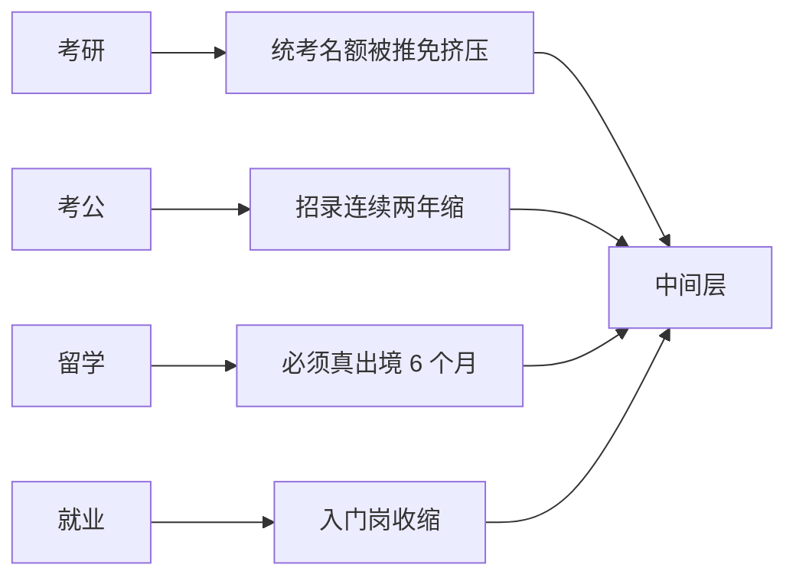

## 〇、三个同时发生的怪事

十月这半个月，有三件事同时发生。

第一件，**考研在降温**。2026 年报名 343 万，比 2023 年的峰值 474 万少了 131 万，连降三年。2027 年的报名 10 月 24 日截止，机构预测在 320 万到 335 万之间。

第二件，**考公在缩招**。2027 年国考 10 月 13 日发公告，计划招录 3.57 万人，比上一年少 2400 人，降幅 6.3%，连续第二年回落。其中 2.69 万投向县乡基层，占 75%。

第三件，**企业还在喊缺人**。制造业的求人倍率是 1.58——每 100 个求职者对应 158 个岗位；智能制造相关的复合岗更高，2.3。万宝盛华《2026 全球制造业劳动力展望报告》说，全球 72% 的制造商招不到合适的技能人才。

再加上第四件：**留学这条路也在收紧**。2026 年中留服新版认证指南要求，一年制硕士境外实际学习时间至少 6 个月（部分专业建议 8 个月），中外合作办学境外累计不少于 180 天；系统会抓取近 10 年的出入境记录做比对，"刷签证""旅游签凑天数"直接失效。截至 2026 年，全球已有 270 所海外院校被移出认证名单。

人少了，岗少了，可企业说招不到人。三句话摆在一起，任何一句单独听都成立，合起来就是矛盾的。

矛盾的原因不在数字，在**结构**：这些队和这些岗位，根本不在同一层。

## 一、先拆"缺人"：缺的是哪一层

"招不到人"这句话，如果不分行业、不分岗位地听，会得出完全相反的结论。分开了看，图景立刻清楚。

2026 年第二季度，制造业整体的求人倍率是 1.58，看着是卖方市场。但拆开是两层：

- **普工岗位 0.85**：供大于求。100 个求职者，只有 85 个岗位。
- **智能制造复合岗 2.3**：极度紧缺。工业机器人运维、PLC 电控调试、数控数字化编程，每个求职者对应 2.3 个岗位。

同一张表里，一边过剩，一边紧缺。说明"缺人"缺的不是数量，是**能同时干几件事的人**。

再看供给端的结构：高技能人才占技能人才总量的比重，从 2020 年的 29.1% 降到 2025 年的 26.4%。塔尖没有变厚，反而在相对变薄——技能劳动者总量在涨，但高技能那一层涨得慢。

长三角一家制造企业的 HR 说得直白：现在不缺按按钮、拧螺丝的工人，缺的是能独立排查故障、微调程序、优化产线效率的复合型人才。

这句话翻译过来就是：**缺的是"中间偏上"那一层。**

<figure>
<svg viewBox="0 0 680 264" width="100%" role="img" aria-label="四条通道挤向收缩中的中间层">
<title>四条通道都指向收缩中的中间层，而中间层上下不通</title>
<defs>
<marker id="m1" viewBox="0 0 10 10" refX="8" refY="5" markerWidth="6" markerHeight="6" orient="auto-start-reverse">
<path d="M2 1L8 5L2 9" fill="none" stroke="context-stroke" stroke-width="1.5" stroke-linecap="round" stroke-linejoin="round"/>
</marker>
</defs>
<rect x="40" y="40" width="140" height="36" rx="8" fill="#0C447C" stroke="#85B7EB" stroke-width="0.5"/>
<text x="110" y="58" font-size="13" fill="#E6F1FB" text-anchor="middle" dominant-baseline="central">考研</text>
<rect x="192" y="40" width="140" height="36" rx="8" fill="#0C447C" stroke="#85B7EB" stroke-width="0.5"/>
<text x="262" y="58" font-size="13" fill="#E6F1FB" text-anchor="middle" dominant-baseline="central">考公考编</text>
<rect x="344" y="40" width="140" height="36" rx="8" fill="#0C447C" stroke="#85B7EB" stroke-width="0.5"/>
<text x="414" y="58" font-size="13" fill="#E6F1FB" text-anchor="middle" dominant-baseline="central">留学</text>
<rect x="496" y="40" width="144" height="36" rx="8" fill="#0C447C" stroke="#85B7EB" stroke-width="0.5"/>
<text x="568" y="58" font-size="13" fill="#E6F1FB" text-anchor="middle" dominant-baseline="central">直接就业</text>
<line x1="110" y1="78" x2="110" y2="108" stroke="#85B7EB" stroke-width="1.5" marker-end="url(#m1)"/>
<line x1="262" y1="78" x2="262" y2="108" stroke="#85B7EB" stroke-width="1.5" marker-end="url(#m1)"/>
<line x1="414" y1="78" x2="414" y2="108" stroke="#85B7EB" stroke-width="1.5" marker-end="url(#m1)"/>
<line x1="568" y1="78" x2="568" y2="108" stroke="#85B7EB" stroke-width="1.5" marker-end="url(#m1)"/>
<rect x="40" y="112" width="600" height="52" rx="10" fill="#633806" stroke="#FAC775" stroke-width="0.5"/>
<text x="340" y="130" font-size="13" font-weight="500" fill="#FAEEDA" text-anchor="middle" dominant-baseline="central">中间层：白领入门岗 · 正在收缩</text>
<text x="340" y="150" font-size="12" fill="#FAC775" text-anchor="middle" dominant-baseline="central">被 AI 挤掉练手岗，被企业要求「立刻能用」</text>
<line x1="180" y1="166" x2="180" y2="196" stroke="#FAC775" stroke-width="1.5" stroke-dasharray="4 3" marker-end="url(#m1)"/>
<text x="192" y="184" font-size="12" fill="currentColor">上不去</text>
<line x1="500" y1="166" x2="500" y2="196" stroke="#FAC775" stroke-width="1.5" stroke-dasharray="4 3" marker-end="url(#m1)"/>
<text x="512" y="184" font-size="12" fill="currentColor">下不去</text>
<rect x="40" y="200" width="290" height="48" rx="8" fill="#0F6E56" stroke="#9FE1CB" stroke-width="0.5"/>
<text x="185" y="218" font-size="13" fill="#E1F5EE" text-anchor="middle" dominant-baseline="central">上层：复合技能岗</text>
<text x="185" y="236" font-size="12" fill="#9FE1CB" text-anchor="middle" dominant-baseline="central">求人倍率 2.3 · 招不到</text>
<rect x="350" y="200" width="290" height="48" rx="8" fill="#501313" stroke="#F7C1C1" stroke-width="0.5"/>
<text x="495" y="218" font-size="13" fill="#FCEBEB" text-anchor="middle" dominant-baseline="central">下层：普工</text>
<text x="495" y="236" font-size="12" fill="#F7C1C1" text-anchor="middle" dominant-baseline="central">求人倍率 0.85 · 过剩</text>
</svg>
<figcaption>四条通道都在往中间挤，而中间层与上下两端之间没有桥。</figcaption>
</figure>

## 二、四条队收紧的其实是同一个口子

把四条队的收紧方式并排放，会发现它们缩的不是同一个东西，但指向同一个结果。

| 通道 | 收紧方式 | 刻度 |
| --- | --- | --- |
| 考研 | 统考名额被推免挤压 | 报名 343 万；推免约四成，统考名额 82–85 万 |
| 考公 | 招录计划连续两年下调 | 2027 招 3.57 万（−6.3%），75% 投基层 |
| 留学 | 认证从"结果审查"改成"过程监管" | 一年制硕士境外 ≥6 个月；270 所院校出局 |
| 就业 | 入门岗位收缩 | 16–24 岁失业率 17.9%（2026 年 7 月） |

四句话可以合成一句：**所有"往上走一格"的通道，都在同一时间变窄。**

考研想拿的是"更高一级的学历"，考公想拿的是"更稳的位置"，留学想拿的是"更有含金量的文凭"，就业想拿的是"第一份像样的工作"。四个目标听起来不同，但它们要的都是同一样东西——**进入中间层的那张票。**

而中间层正在塌。

## 三、留学为什么也收紧了

这件事最容易被忽略，因为它看起来只是"认证流程变严"。

但把新规的条文摊开看，它改的不是流程，是**审查的对象**：过去认证只看那张学位证——学校在名单里、证书是真的，就认。现在要看过程——你在境外实际待了多久、课程是不是线下、出入境记录能不能和课程表对上。

这是一次逻辑切换：**从"结果审查"到"过程监管"。**

为什么切？两个原因，一个明一个暗。

明的原因是水项目太多。全程网课拿学位、"旅游签凑天数"、挂靠院校，这些操作把"留学"这个凭证的含金量稀释了。270 所院校被移出名单，就是这个逻辑的产物。

暗的原因是：**认证是留学这条路的最后一道闸。** 只要认证还认"纸"，留学就永远可以变成"花钱买纸"；一旦认证开始查"人"，这条路的成本就被抬回到了"真的要在国外生活半年到一年"。

这和论文分区退场、学历认证收紧是同一件事的三个面：**凭证通胀之后，体系只能从"查凭证"转向"查过程"。** 因为凭证可以买，过程买不了——至少买起来贵得多。

所以"留学也变严了"不是一个孤立政策。它是四条队同时收窄的第四条：**用钱换赛道的通道，被要求真的待在赛道上。**

## 四、中间层为什么塌

有三个机制，同时作用。

**第一个，AI 把练手岗吃掉了。**

10-18 那篇算过：便宜模型把标准工程的成本压到每任务一元多，77 分的活儿一块多钱。这意味着企业不需要那么多"执行层"了——写脚本、改 bug、做报表、整理数据，这些活以前是新人练手的地方，现在模型干得又快又便宜。

练手岗消失的后果不是"少招几个人"，是**新人没有地方变成熟手**。而中间层恰恰是"熟手"那一层。

**第二个，企业不再培养人。**

万宝盛华那份报告里有个数字比"72% 招不到人"更刺眼：60% 的制造业工人在过去六个月内没有接受过任何形式的技能培训。

雇主在喊缺人，工人却没在成长。这不是巧合，是同一个决策的两面：培训是长期投入，挖人是短期解法，当所有人都选后者，市场上就永远缺"已经会的人"。

**第三个，教育供给慢半拍。**

学校培养的是"昨天的技术"，企业要的是"明天的技能"。这个错位在经济增速快的时候被增长掩盖了——反正岗位在增加，学得偏一点也能被吸收。增速一慢，掩盖物没了，错位就露出来了。

三个机制叠在一起，结果就是：**上面缺人，下面过剩，中间挤满了刚毕业的人。**

## 五、三把尺子，量不出同一个人

错配的深处，是评价标准不通用。

- **学校用分数排序**：绩点、排名、保研资格。
- **企业用经历筛人**：实习、项目、上一份工作。
- **市场用技能定价**：能不能立刻上手，能不能解决没见过的故障。

这三把尺子各自都合理，但它们不换算。分数高的人可能没经历，有经历的人可能没学历，有技能的人可能没文凭。而四条队的设计，本质上是让人**在同一个体系里反复换尺子**：考研换学历的尺子，考公换考试的尺子，留学换认证的尺子，就业换经历的尺子。

换尺子的成本，由个人承担。

这就解释了一个很常见的困惑：为什么"很努力的人"也会失业？不是努力不够，是**努力用在了另一把尺子上**。

## 六、谁卡在中间层

最难受的不是最上面，也不是最下面，是普通本科这一层。

往上，复合技能岗要的是"人—车—路—云"多域融合的能力，要项目、要故障经验、要能独立判断，这些不是课堂能给的；往下，普工岗位虽然过剩，但它的定价和尊严预期与本科四年的投入不匹配——不是不能去，是去了要重新解释自己。

于是他们去做第三件事：**继续排队。** 考研、考公、考编、考证、考留学，每一条队都是"再给自己一年"。四条队同时变短，不是因为排队的人变少了，是因为**只能排队的人变多了**。

这也是为什么"降温"和"拥挤"可以同时成立：报名人数在降，是因为一部分人退出了；剩下的竞争更激烈，是因为退出的人没有离开，他们只是换了一条队，或者换了一个年份。

## 七、出路不是"往下兼容"

每次聊到这里，都会有人给出两个建议：要么"放下身段，先就业再择业"，要么"提升学历，卷到更高"。

这两句话都不算错，但它们都假设了一件事：**中间层是通的，只是你不够努力。**

可数据显示的不是这样。普工 0.85 的求人倍率说明它不是"身段问题"，是**岗位真的在减少**；复合岗 2.3 的缺口说明它不是"学历问题"，是**技能真的对不上**。一个人从中间层往下走，遇到的是过剩；往上走，遇到的是技能门槛。两边都不是"愿不愿意"能解决的。

真正在发生的，是三条别的路：

**第一条，换尺子。** 从"学历尺"换到"技能尺"——职业本科、技能证书、专项培训。这条路政策上在推（职业本科已有 124 所、在校生超 50 万），但它的社会评价还没跟上，走的人要承受"降级"的目光。

**第二条，补复合。** 不是再学一门课，是把自己变成"两个领域的交界处"——会编程的机械、懂临床的算法、能写清楚的工程师。复合岗的缺口就是这么来的，它不是"更难的单一技能"，是"两种技能的交集"。

**第三条，出海。** 把中国的工程能力、制造经验、成本结构带到还在扩张的市场去。这条路门槛不在能力，在信息和胆量。

三条路都不轻松，但至少它们不是"再考一年"。

## 八、桥的问题

回到开头那三个怪事：人少了，岗少了，企业说招不到人。

这三句话合起来只说明一件事：**这个市场缺的不是人，也不是岗位，是桥。**

从学校到岗位的桥，从普工到技师的桥，从学历到技能的桥，从"考上了"到"能干活"的桥。过去二十年，这些桥是靠"增长"搭的——岗位年年增加，走偏一点也能被接住。增长慢下来之后，桥就露出来了：有的断了，有的从来没建。

四条队同时变短，不是四条路都走不通，是**所有人都被赶到了同一座桥的入口**。而那座桥的宽度，是按二十年前的流量设计的。

10-18 那篇说，这一轮被拿走的是"可规划性"；10-19 那篇说，三条队都在变短，退出成了默认选项。这一篇想补的是：**退出和排队都不是问题，问题是桥没修。**

修桥这件事，个人做不了。个人能做的，是别再挤那座最窄的桥——但这需要有人告诉他，还有别的桥。

## 附：口径

- 考研报名 343 万（2026）、峰值 474 万（2023）、2027 报名 10 月 24 日截止：教育部序列与研招网公告；2027 人数为机构预测，非官方。
- 2027 国考招 3.57 万、−6.3%、连续两年下降、75% 投基层：公告及新华网、中国青年网报道。
- 制造业求人倍率 1.58、普工 0.85、智能制造复合岗 2.3、高技能人才占比 29.1%→26.4%、制造业十大重点领域缺口约 3000 万：均据行业报告与媒体转述人社部数据，非官方原始发布，按"据行业报告"处理；3000 万为总量口径，与细分口径不可混用。
- 万宝盛华《2026 全球制造业劳动力展望报告》：72% 制造商招不到合适技能人才、60% 工人半年内无培训——据该报告转述。
- 16–24 岁不含在校生失业率 17.9%（2026 年 7 月）：国家统计局月度数据。
- 中留服 2026 版认证指南：一年制硕士境外 ≥6 个月（建议 8 个月）、中外合作办学 ≥180 天、10 年出入境记录比对、270 所院校移出名单——据多家留学服务机构对新规的转述，未取官网原文，引用时以"据新规要点"为限。
- 职业本科 124 所、在校生超 50 万：据行业报告，截至 2026 年 6 月。
