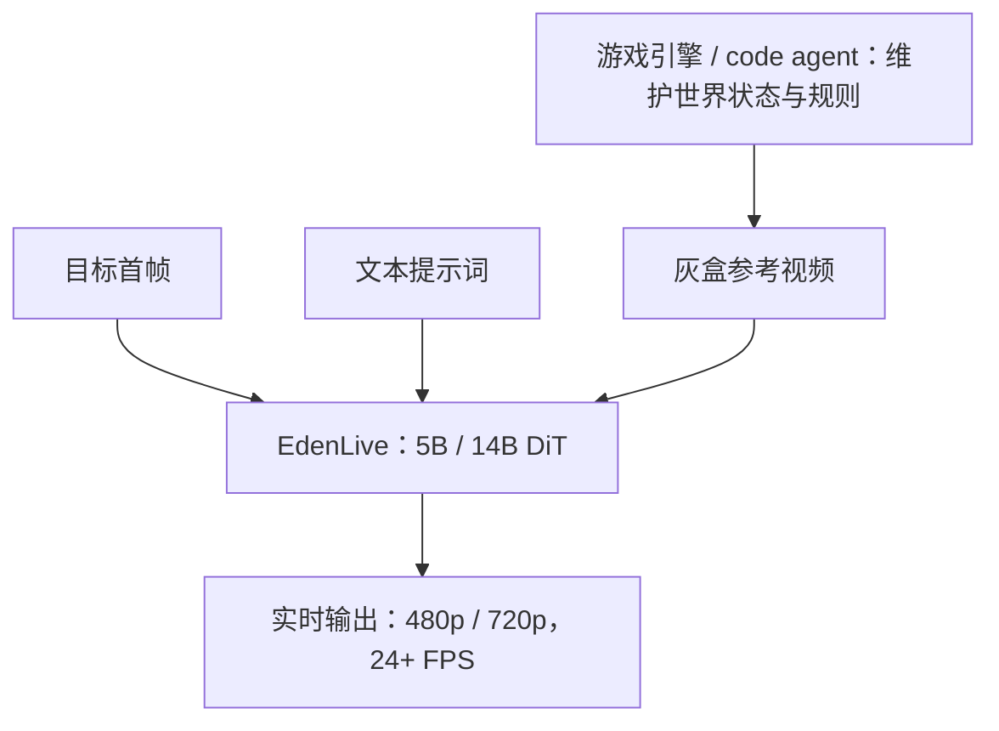
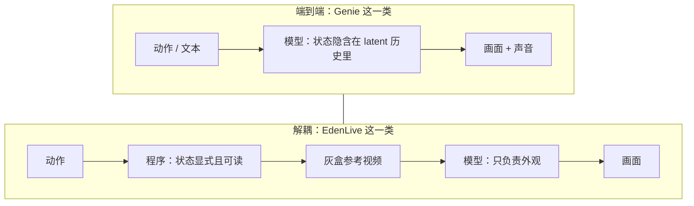

## 〇、八天里的两个"世界模型"

10 月 19 日，VAST（Tripo 背后的研究团队）开源了 EdenLive。它的说明书写得很克制：给一段参考视频——游戏引擎输出的灰盒画面、法线动画、或者实拍——再给一张目标首帧和一句提示词，它把这段视频实时渲染成照片级或指定画风的画面。5B 模型在单张 RTX 5090 上，1280×704 跑到约 24.7 FPS。

10 月 27 日，Google DeepMind 发布 Genie 4。同一句话可以套上去：给它一句话，它生成一个你能走进去的世界。区别在于它同时生成声音——环境音、音乐、以及能跟你对话的角色。

两个东西都被叫"世界模型"。但它们解决的不是同一个问题。

EdenLive 的架构里，**世界怎么运转，不归模型管**。规则由上游的程序决定——一个游戏引擎，或者一段 coding agent 写出来的代码——程序维护状态，输出一段粗糙的参考视频，模型只负责把这层粗糙的外壳换成真实的外观。

Genie 4 的架构里，**世界怎么运转，就是模型本身**。你按键，它生成下一帧；物理、碰撞、人物动作、声音，全在同一个生成过程里发生。

这个差别看起来是工程细节，其实是这一轮世界模型最值得看清楚的一条分界线。因为它决定了一件很实际的事：**你能对哪一个部分写测试。**

## 一、先把 EdenLive 的接口看清楚

世界模型这个词被用得太松，容易糊。EdenLive 的接口定义得很窄，窄到可以画出来：

三个输入，一个输出。关键在上面那条路径：**参考视频里已经包含了场景布局、镜头运动、动力学**。EdenLive 不需要猜"玩家按了前进之后世界会变成什么样"——那件事已经有人算完了，算的人是一个确定性的程序。它要做的，是把这段"对但丑"的视频，变成"对而且像"的视频。

VAST 自己的说法是"把状态的演化与外观解耦"。首席科学家曹彦培把 Project Eden 分成三层：持续演化的世界状态、状态到视觉的接口、生成式渲染器。EdenLive 实现的是后两层，且**不限制第一层怎么实现**。

这句话的份量在"不限制"三个字上。第一层可以是 Unity，可以是自写的物理引擎，可以是一段 agent 生成的代码，甚至可以是一段录好的实拍。模型不关心。

## 二、"实时"有两种含义，官方数字说的是第二种

24.7 FPS 这个数字，很容易被读成"你按下按键，41 毫秒后就看到画面"。不是。

技术报告里有一张表，把这件事拆得很清楚（单卡 H100，预热后）：

| 配置 | 分辨率 | 卡数 | 生成吞吐 | 推理吞吐 | 首帧延迟 |
| --- | --- | --- | --- | --- | --- |
| 5B | 832×480 | 1 | 80.68 FPS | 73.52 FPS | 826 ms |
| 5B | 1280×704 | 1 | 31.04 FPS | 29.80 FPS | 1162 ms |
| 14B | 832×480 | 8 | 28.81 FPS | 26.76 FPS | 1714 ms |

**首帧延迟 1.16 秒，吞吐 29.8 FPS。** 这两个数字不矛盾，它们量的是不同的事。

吞吐说的是稳态：一旦管线转起来，每秒钟能吐出多少帧。延迟说的是从你给输入到第一帧出现要多久。一个实时渲染系统可以吞吐很高、延迟很差——只要它一直有东西可渲染。

"实时"在这里的正确读法是：**它能跟上 24 FPS 的播放节奏，不卡顿**。它不是"零延迟"。这两件事在游戏引擎里也是分开的：一个游戏可以稳定 60 帧，但你的输入到屏幕可能要经过两三帧的缓冲。

所以 24 FPS 这个门槛的真正含义，不是"够快"，而是"够上播放器"。24 是电影的标准帧率，低于它，人眼开始感到断裂；高于它，多出来的帧对观感边际收益很小。这是一个**刚好够用**的目标，不是一个性能炫技。

顺带一个容易漏的算术。管线是分块生成的：每块 3 个 latent 帧，4 步采样。3 个 latent 帧展开成 12 个像素帧——首块是 9 帧，因为第一帧是给定的条件帧。所以在 24.7 FPS 下，每块的预算大约是：

$$12 \div 24.7 \approx 0.486\ \text{s}$$

486 毫秒里要完成：条件编码、4 步去噪、解码、把 RGB 搬到客户端。这个预算才是所有工程取舍的起点。

<figure>
<svg viewBox="0 0 680 210" width="100%" role="img" aria-label="一块 12 帧、486 毫秒的帧预算如何被切分">
<title>每块 12 个像素帧的 486 毫秒预算，被四个阶段依次吃掉</title>
<defs>
<marker id="bd2" viewBox="0 0 10 10" refX="8" refY="5" markerWidth="6" markerHeight="6" orient="auto-start-reverse">
<path d="M2 1L8 5L2 9" fill="none" stroke="context-stroke" stroke-width="1.5" stroke-linecap="round" stroke-linejoin="round"/>
</marker>
</defs>
<text x="40" y="24" font-size="11" fill="currentColor">一块的预算：12 帧 ÷ 24.7 FPS ≈ 486 ms</text>
<line x1="40" y1="40" x2="640" y2="40" stroke="#85B7EB" stroke-width="2"/>
<line x1="40" y1="34" x2="40" y2="46" stroke="#85B7EB" stroke-width="2"/>
<line x1="640" y1="34" x2="640" y2="46" stroke="#85B7EB" stroke-width="2"/>
<text x="40" y="60" font-size="10" fill="#85B7EB" text-anchor="middle">0</text>
<text x="640" y="60" font-size="10" fill="#85B7EB" text-anchor="middle">486 ms</text>
<rect x="40" y="74" width="90" height="40" rx="6" fill="#0C447C" stroke="#85B7EB" stroke-width="0.5"/>
<text x="85" y="92" font-size="11" font-weight="500" fill="#E6F1FB" text-anchor="middle">条件编码</text>
<text x="85" y="107" font-size="10" fill="#85B7EB" text-anchor="middle">DINO 读草稿帧</text>
<rect x="134" y="74" width="250" height="40" rx="6" fill="#633806" stroke="#FAC775" stroke-width="0.5"/>
<text x="259" y="92" font-size="11" font-weight="500" fill="#FAEEDA" text-anchor="middle">4 步去噪（决定「画什么」）</text>
<text x="259" y="107" font-size="10" fill="#FAC775" text-anchor="middle">这段是主体，省不掉</text>
<rect x="388" y="74" width="148" height="40" rx="6" fill="#0F6E56" stroke="#9FE1CB" stroke-width="0.5"/>
<text x="462" y="92" font-size="11" font-weight="500" fill="#E1F5EE" text-anchor="middle">解码</text>
<text x="462" y="107" font-size="10" fill="#9FE1CB" text-anchor="middle">把 latent 翻成像素</text>
<rect x="540" y="74" width="100" height="40" rx="6" fill="#0C447C" stroke="#85B7EB" stroke-width="0.5"/>
<text x="590" y="92" font-size="11" font-weight="500" fill="#E6F1FB" text-anchor="middle">搬运</text>
<text x="590" y="107" font-size="10" fill="#85B7EB" text-anchor="middle">RGB 到客户端</text>
<line x1="462" y1="120" x2="462" y2="142" stroke="#9FE1CB" stroke-width="1.5" marker-end="url(#bd2)"/>
<text x="472" y="158" font-size="11" fill="#9FE1CB">下一节只动这一段</text>
<text x="40" y="188" font-size="11" fill="currentColor">四段是串联的：任何一段超标，整块的 486 ms 就守不住，吞吐掉到 24 FPS 以下。</text>
</svg>
<figcaption>486 毫秒是此后所有取舍的起点。注意四段是串联而非并联——它们加起来不能超过一条横线的长度。</figcaption>
</figure>

## 三、被换掉的那个解码器

如果只能从这份技术报告里挑一个细节讲，我会挑这个：**他们把 VAE 解码器换掉了。**

原生的 Wan VAE 解码器很重。在离线生成里这不是问题——你生成一段五秒的视频，多等两秒没人介意。但在 486 毫秒的预算里，解码器占的比例足以毁掉整条管线。

他们的做法是换成 LightX2V 的轻量 TAE 解码器（TAEHV）。这个替换能成立，靠的是一个前提：**轻量解码器和原生解码器共享同一套压缩比，所以能解码同一批 latent**。也就是说，前面 4 步去噪算出来的东西不用改，只是换了一个更便宜的"翻译官"把 latent 翻成像素。

这个动作在别的领域有完全同构的先例。大模型推理里的投机解码（speculative decoding）：用一个小模型快速起草，大模型负责验证。两件事的共同点是——

**把算力挪到真正改变答案的地方去。**

去噪那 4 步决定"画什么"，解码只决定"画成什么颜色"。前者不能省，后者可以换便宜的。这是实时系统设计里最经典的一类判断：找到关键路径上那个"贵但不改变结果"的环节，然后把它换掉。

管线里还有两个不那么显眼、但同样关键的设计。

**一是分块自回归。** 不是一次生成整段，而是一块一块往前推，每块 4 步。这带来一个副作用：注意力窗口会随时间无限增长，而模型是在固定长度的序列上训练的。技术报告里那句话写得很技术，但意思是全部的：

> 让 query–key 的偏移在整个会话中始终落在训练范围内。

翻译过来：**用滚动窗口 + 位置偏移管理，让一个只在短视频上训练过的模型，能连续跑几分钟而不崩**。这是一个"训练分布对齐"的问题，不是"显存不够"的问题。很多长视频方案在这里翻车，不是因为算不动，是因为跑着跑着就出了训练时没见过的偏移范围。

**二是缓存。** 每块生成时，前面块的结果以 KV cache 的形式留着。但缓存不能无限留，所以还得管"留多少、丢哪些"。这部分没有在报告里展开，但仓库里那个容器化移植目录的笔记透露了它的代价：调优前后，从按键到收到画面的延迟从 1.24–1.32 秒降到 0.69–0.86 秒；在 B200 上，调优后的配置测得约 57.6 FPS（每 12 帧 0.208 秒），而原始 eager 配置是 25.8 FPS。同一个模型，两倍多的差距，全在工程里。

## 四、另一条路：Genie 4 把状态藏进模型

现在把镜头转到 Genie 4，会看到完全相反的取舍。

Genie 4 没有"上游程序"。你给一句话，它建一个世界；你按键，它生成下一帧；你输入文本，它实时改天气、移镜头、加人加物。物理、碰撞、人物动作、声音，都在同一个生成过程里发生。

它这一代加了四件事：

1. **实时塑造**：自然语言在模拟进行中改场景，Gemini 会把你的提示词"上下文化"，让它贴合当前画面。
2. **物理与人**：官方演示里有枫树种子下落、西瓜受力、空气动力学，以及"更接近真人"的角色动作。
3. **原生音频**：环境音、音乐，以及能对事件和你输入做出反应的对白。官方强调所有演示里的声音都由模型直接产生。
4. **Gemini 当导演**：Gemini 3.8 Flash 在环路里当"引导 agent"，观察画面、把目标拆成步骤、检查每一帧是否完成了这一步。Gemini 4 Argon 则在一个机器人实验里，把任务拆成步骤喂给 Genie 4，模拟 Apptronik 的 Apollo 人形机器人下跳棋。

注意第四件事的架构含义。Genie 4 本来是端到端的：状态藏在 latent 历史里，没人能读出来。现在外面套了一个语言模型当"导演"，把**步骤**显式化了。步骤是文本，文本是可检查的。

也就是说，**连端到端这条路，也在往"把状态说出来"的方向补。** DeepMind 研究总监在发布会上给这个方向起了名字：混合世界模型（hybrid world models）——Gemini 写代码和文本，Genie 实时接收，在不同抽象层级上模拟现实。

这句话和 EdenLive 的"不限制第一层怎么实现"，其实是同一个洞察从两端说出来的：**纯生成的世界，缺一个能被程序读写的状态层。**

## 五、状态放在哪，决定了你能验证什么

这一节是全文的核心。

把两条管线放在一起，会看到一个非常干净的对称：

差别不在"谁更先进"，在**失败模式**和**可验证性**：

| | 端到端（Genie 类） | 解耦（EdenLive 类） |
| --- | --- | --- |
| 状态在哪 | 隐含在模型历史里 | 一段普通程序的内存里 |
| 能单测逻辑吗 | 不能 | 能，就是普通代码 |
| 失败表现 | 物理开始"不对劲" | 画面很漂亮，但严格跟着灰盒走 |
| 改一个变量只重渲染 | 做不到 | 可以，改状态重跑 |
| 能发明新行为吗 | 能（涌现） | 不能（只渲染给定的） |
| 数据需求 | 真实交互轨迹 | 成对的（粗/细）视频 |
| 训练目标 | 学会世界 | 学会世界的表面 |

第三行和第四行是同一个事实的两面。Genie 那条路的失败，是"世界开始不讲理"——物体穿模、走久了漂移、文字糊掉。这些在官方"当前局限"里被诚实列出来了：细节与物体恒常性会随时间漂移，尤其是长时运行、多次复杂提示编辑、或穿行场景之后；复杂物理交互、实时音频准确性、可读文字、空间准确性都还在研究中。

EdenLive 那条路的失败，是"它不预测世界"。它不猜球会弹几下，它照着灰盒把球画出来。灰盒错了，它画得再真也是错的。

**一个负责"会发生什么"，一个负责"看起来像什么"。** 谁也不能单独构成一个完整的世界。这句话听起来像和稀泥，但它有很硬的操作含义：端到端模型的错误无法归因，解耦模型的错误可以归因到"逻辑错"还是"渲染错"两类，分别测。

而这正是工程上最值钱的东西。一个不能被归因的系统，只能整体重训；一个能被归因的系统，可以只换坏的那一半。

### 分离架构真正的红利是数据

上面这些还是架构层面的好处。真正的红利在数据。

EdenLive 需要的是**成对数据**：同一段场景的一份粗版本和一份精版本。而这类数据可以自动生成——同一套场景资源，用引擎的低画质模式渲一遍，用高画质模式渲一遍，就得到一对。理论上可以无限产。

Genie 那条路要学的是"动作 → 像素"，这就需要真实的交互轨迹。Matrix-Game 系列为此建了一条数据生产线，从 Unreal Engine 和 GTA5 里产出约 1200 小时的带交互标注的视频。这不是一个数量级的差别，是两种完全不同的成本结构：一个的成本在**渲染**，一个的成本在**采集**。

而渲染是可以并行、可以合成的；采集不行。

这可能才是 EdenLive 这类方案在 2026 年真正的位置——不是"更弱的世界模型"，是"一条数据成本低一个量级的外观层"。它放弃了预测世界的野心，换来了可以无限造训练数据的能力。

<figure>
<svg viewBox="0 0 680 272" width="100%" role="img" aria-label="两条路线的训练数据来源与成本曲线">
<title>成对数据可以自动生成，交互轨迹必须采集</title>
<defs>
<marker id="dt1" viewBox="0 0 10 10" refX="8" refY="5" markerWidth="6" markerHeight="6" orient="auto-start-reverse">
<path d="M2 1L8 5L2 9" fill="none" stroke="context-stroke" stroke-width="1.5" stroke-linecap="round" stroke-linejoin="round"/>
</marker>
</defs>
<text x="30" y="22" font-size="11" fill="currentColor">解耦：成本在渲染</text>
<rect x="30" y="32" width="120" height="34" rx="6" fill="#0C447C" stroke="#85B7EB" stroke-width="0.5"/>
<text x="90" y="53" font-size="11" fill="#E6F1FB" text-anchor="middle">同一套场景资源</text>
<line x1="154" y1="49" x2="180" y2="49" stroke="#85B7EB" stroke-width="1.5" marker-end="url(#dt1)"/>
<rect x="184" y="32" width="112" height="34" rx="6" fill="#0C447C" stroke="#85B7EB" stroke-width="0.5"/>
<text x="240" y="53" font-size="11" fill="#E6F1FB" text-anchor="middle">低画质渲一遍</text>
<rect x="184" y="74" width="112" height="34" rx="6" fill="#0C447C" stroke="#85B7EB" stroke-width="0.5"/>
<text x="240" y="95" font-size="11" fill="#E6F1FB" text-anchor="middle">高画质渲一遍</text>
<line x1="300" y1="49" x2="326" y2="68" stroke="#85B7EB" stroke-width="1.5" marker-end="url(#dt1)"/>
<line x1="300" y1="91" x2="326" y2="72" stroke="#85B7EB" stroke-width="1.5" marker-end="url(#dt1)"/>
<rect x="330" y="52" width="130" height="34" rx="6" fill="#0F6E56" stroke="#9FE1CB" stroke-width="0.5"/>
<text x="395" y="73" font-size="11" font-weight="500" fill="#E1F5EE" text-anchor="middle">一对成对数据</text>
<text x="40" y="130" font-size="11" fill="#9FE1CB">→ 可并行、可合成，理论上可以无限产</text>
<text x="30" y="164" font-size="11" fill="currentColor">端到端：成本在采集</text>
<rect x="30" y="174" width="150" height="34" rx="6" fill="#633806" stroke="#FAC775" stroke-width="0.5"/>
<text x="105" y="195" font-size="11" fill="#FAEEDA" text-anchor="middle">Unreal / GTA5 环境</text>
<line x1="184" y1="191" x2="210" y2="191" stroke="#FAC775" stroke-width="1.5" marker-end="url(#dt1)"/>
<rect x="214" y="174" width="170" height="34" rx="6" fill="#633806" stroke="#FAC775" stroke-width="0.5"/>
<text x="299" y="195" font-size="11" fill="#FAEEDA" text-anchor="middle">约 1200 小时交互视频</text>
<line x1="388" y1="191" x2="414" y2="191" stroke="#FAC775" stroke-width="1.5" marker-end="url(#dt1)"/>
<rect x="418" y="174" width="180" height="34" rx="6" fill="#633806" stroke="#FAC775" stroke-width="0.5"/>
<text x="508" y="195" font-size="11" fill="#FAEEDA" text-anchor="middle">带动作标注的轨迹</text>
<text x="40" y="232" font-size="11" fill="#FAC775">→ 必须逐条采集，成本随需求线性上升</text>
<text x="40" y="262" font-size="11" fill="currentColor">注意这条差异不会随算力变便宜而消失：采集是人力与里程，不是浮点运算。</text>
</svg>
<figcaption>同一个目标（让模型学会世界），两条路的成本结构完全不同：一个按渲染量计费，一个按采集量计费。</figcaption>
</figure>

## 六、数字背后的几层口径

看这类发布，最容易犯的错是拿官方数字直接横比。这里有四层必须说清的口径。

**第一，FPS 是吞吐，不是延迟。** 前面已经拆过：1.16 秒首帧，29.8 FPS 稳态。厂商宣传页上的"24+ FPS"说的是后者。而"实时可交互"这个说法，在端到端模型那里还多一层——Genie 4 是"可信测试者"预览，没有公开的延迟数字。

**第二，"单卡 5090"和"已验证配置"不是同一套。** README 里 24.7 FPS @ 1280×704 走的是 LightX2V 的量化、算子融合、CUDA Graphs 那条路；而官方标注的已验证环境是 80GB 显存的卡加 CUDA 13。两套配置都能跑，但它们不是一回事。同理，14B 那个 26.76 FPS 需要 8 张 H100——**"开放权重"从来不等于"能在你机器上跑"**。

**第三，权重是 210 GB。** 5B、14B 各带双向和少步两个版本，加上两套 VAE、两套 TAE 解码器、文本编码器。下载一次两百多 GB，这个门槛比"开源"两个字听起来高得多。

还有一个更隐蔽的口径问题，在"一致性时长"上，而且它值得单独说，因为它是二手转述最常出错的地方。

Genie 3 的官方博文写的是两句不同的话：环境"在几分钟内基本保持一致"，而"视觉记忆能回溯到一分钟前"。前者说的是画面不崩，后者说的是模型记得多久以前的东西。这两个指标不是一回事。

Genie 4 发布后，中文转述里普遍出现了一个"约两分钟，是上一代的两倍"的说法。但这句话和 Genie 3 官方说的"几分钟"对不上——按字面读，它比上一代更短。两种可能：要么那个数字量的是另一件事（比如完全不漂移的连续段长度），要么转述时把两个指标混成了一个。**在拿到一手表述之前，本文不采用这个数字。** 这一条本身就是个例子：一个数字在转述链上走两站，量纲就变了。

## 七、怎么判断一个世界模型值不值得动手

不给结论，给五个能查的量。它们都不需要你相信任何一句宣传。

**第一，帧预算是多少，量的是哪个。** 分辨率、单卡还是多卡、FPS 是吞吐还是端到端延迟。一个诚实的发布会把首帧延迟单独列出来——EdenLive 的技术报告列了，这本身就是个信号。

**第二，状态在哪，能不能脱离模型单独跑。** 这是最硬的判据。如果世界逻辑能作为一段普通程序单独运行、单独测试、单独修改，那它是一个可工程化的系统；如果它只存在于模型的隐状态里，那它只能整体重训。你可以直接问：**把画面关掉，逻辑还跑得动吗？**

**第三，训练数据从哪来，能不能自动扩。** 成对数据可以自动生成，交互轨迹不行。这一条决定了这个方案的成本曲线是平的还是陡的。

**第四，"开源"到底开了哪几层。** EdenLive 的许可证是分层的：推理代码、核心扩散模型、VAE、解码器权重是 Apache 2.0；视觉编码器跟 DINOv3 的许可走；而那个"文字变游戏"工作台用的图像模型是 FLUX 非商用许可。所以工作台只能非商用，但视频生成本身不依赖它。**看到"开源"两个字，先去找 NOTICE 文件，不要看 README 的标题。**

<figure>
<svg viewBox="0 0 680 246" width="100%" role="img" aria-label="EdenLive 各层组件的许可证分层">
<title>一个仓库，三种许可证：能用、跟随上游、只能非商用</title>
<text x="30" y="24" font-size="11" fill="#9FE1CB">① 可商用 · Apache 2.0</text>
<rect x="30" y="34" width="140" height="32" rx="6" fill="#0F6E56" stroke="#9FE1CB" stroke-width="0.5"/>
<text x="100" y="54" font-size="11" fill="#E1F5EE" text-anchor="middle">实时推理代码</text>
<rect x="180" y="34" width="140" height="32" rx="6" fill="#0F6E56" stroke="#9FE1CB" stroke-width="0.5"/>
<text x="250" y="54" font-size="11" fill="#E1F5EE" text-anchor="middle">核心扩散模型 DiT</text>
<rect x="330" y="34" width="120" height="32" rx="6" fill="#0F6E56" stroke="#9FE1CB" stroke-width="0.5"/>
<text x="390" y="54" font-size="11" fill="#E1F5EE" text-anchor="middle">VAE 权重</text>
<rect x="460" y="34" width="150" height="32" rx="6" fill="#0F6E56" stroke="#9FE1CB" stroke-width="0.5"/>
<text x="535" y="54" font-size="11" fill="#E1F5EE" text-anchor="middle">TAE 解码器权重</text>
<text x="30" y="92" font-size="11" fill="#FAC775">② 跟随上游 · DINOv3 许可</text>
<rect x="30" y="102" width="180" height="32" rx="6" fill="#633806" stroke="#FAC775" stroke-width="0.5"/>
<text x="120" y="122" font-size="11" fill="#FAEEDA" text-anchor="middle">视觉编码器</text>
<text x="30" y="160" font-size="11" fill="#F7C1C1">③ 仅非商用 · FLUX Non-Commercial</text>
<rect x="30" y="170" width="200" height="32" rx="6" fill="#501313" stroke="#F7C1C1" stroke-width="0.5"/>
<text x="130" y="190" font-size="11" fill="#FCEBEB" text-anchor="middle">文字变游戏工作台</text>
<text x="250" y="190" font-size="10" fill="currentColor">只用于工作台的首帧渲染，视频生成链路不加载它</text>
<text x="30" y="226" font-size="11" fill="currentColor">所以「开源」的准确说法是：视频生成可以商用，那个一键出游戏的前端不行。</text>
</svg>
<figcaption>看 NOTICE 文件而不是 README 标题：同一个仓库里，能商用的和只能看看的，是分开的两层。</figcaption>
</figure>

**第五，有没有第三方在标准化场景上比过。** 这一条现在最弱。WorldMark 那篇工作说得很直接：每个模型都在自己的基准、自己的场景、自己的轨迹上评测，跨模型比较根本不可能。他们用统一起点测了六个模型，结论里有一条特别值得记住——**画面好看和结构稳定经常不相关**。同一个 Matrix-Game 2.0，从第一人称切到第三人称，旋转误差涨了近 20 倍。

换句话说：**"看起来像世界"和"是世界"是两件事，而人类的眼睛分不出来。** 这就是为什么需要基准，也是为什么现在的基准还不够。

## 八、这一年，世界模型开始变成一门生意

把时间轴拉开，会看到 2026 年 9 月以来这条线上挤满了动作：

- 9 月，Runway 发布 GWM Worlds 2，能响应用户输入、带音频。
- 9 月 28 日，AMD 宣布以约 82 亿美元全股票收购 World Labs，李飞飞加入 AMD 任执行副总裁兼首席科学家。
- 10 月 19 日，VAST 开源 EdenLive。
- 10 月 22 日，Rivian 收购 Third Dimension，把模拟能力收进自动驾驶测试。
- 10 月 27 日，Genie 4 发布。
- 同期，《华尔街日报》报道亚马逊正在洽谈以约 70 亿美元收购 Decart。

两个月，三笔交易或谈判，一个开源发布，一次旗舰更新。

这条线的形状值得注意：**买的人不是模型公司，是芯片公司和车厂。** AMD 买 World Labs，图的是"理解模型怎么演化，才能设计下一代硬件"；Rivian 买 Third Dimension，图的是自动驾驶的仿真测试——它每天从车主车队收到四十多万段视频，其中绝大多数是无聊的正常行驶，真正能打穿系统的场景（快车道上一张床垫、交警挥手让车闯红灯、小孩从两辆车之间冲出来）出现得极少。Third Dimension 做的事，是**把真实场景重建成可编辑的 3D 环境，然后自己改变量**。

这里有个细节值得注意，因为它和本文的主线是同一件事：Third Dimension 被反复强调的卖点是"重建真实场景"，而不是"用物理规则模拟一个假世界"。同一时期，Waymo 的世界模型则建在 Genie 3 之上，用来生成车队从没见过的场景。**同一个行业，两条路同时在用。**

这也解释了为什么"状态放在哪"这个问题会变得重要。如果世界模型最终的主流形态是"程序管逻辑 + 模型管外观"，那它就是一个**可以被拆开部署、拆开计费、拆开替换**的系统；如果主流形态是端到端的黑盒，那它就是一个 API，你只能按次付费，也只能整体升级。

两条路都会有生意。但它们长出来的生态完全不同。

## 九、留给读者的三个判断

写到这里，回到最开始那个问题：两个都被叫世界模型的东西，差的到底是什么。

**第一，差在谁拥有状态。**

拥有状态的一方，拥有可测试性、可迁移性、可归因性。这也是为什么连 Genie 都在往"把步骤说出来"的方向补：Gemini 当导演，把任务拆成文本步骤——文本是可以被检查的。纯端到端的世界很美，但美不可测。

**第二，差在成本曲线的形状。**

成对数据可以自动生成，交互轨迹不能。这条差异不会因为模型变大而消失，只会因为数据需求变大而放大。EdenLive 那种"只学表面"的定位，本质上是把学习目标从"世界"缩到"世界的表面"，用这个收缩换来了数据的可扩性。

**第三，差在你该拿它做什么。**

想做一个能玩的场景原型、想快速试镜头、想把实拍改成另一种画风——解耦那条路今天就能在单张消费级卡上跑，代价是你得自己写那个灰盒。想要一个能涌现出你没设计过的行为的世界——端到端那条路今天还只在"可信测试者"手里，代价是你没法验证它为什么对、为什么错。

最后一句关于"实时"的提醒。这一轮所有世界模型都在比 FPS，但**帧率不是体验**。你在一个 24 FPS 的世界里按下前进键，画面确实在动；真正决定你信不信这个世界的，是你在里面走了一分钟之后，那棵树还在不在原来的位置。

Genie 4 把这件事交给模型自己维持——越久越容易漂，所以"能维持多久"本身成了它的核心指标。EdenLive 把这件事外包给了引擎——引擎里的树，走一天也不会挪。**一个是把不确定性压缩在一段时长以内，一个是把不确定性直接删掉。** 这两种解法，未来大概会同时存在，因为它们回答的不是同一个问题。

---

**口径说明。** 文中的 FPS 与延迟数字分两类：EdenLive 的 73.52 / 29.80 / 26.76 FPS 与 826 / 1162 / 1714 毫秒首帧延迟来自其技术报告表 2、表 3（H100，预热后，3 个 latent 帧一块、4 步采样、LightTAE 解码）；24.7 FPS @ 1280×704 来自 README 在 RTX 5090 + LightX2V 下的配置；57.6 FPS 与 0.69–0.86 秒延迟来自仓库内 `reactor/` 移植目录的调优笔记（B200）。Genie 4 的"约两分钟"只出现在发布会的中文转述中，DeepMind 官方博文未给出数字，只写"能在短会话中维持连贯环境"并把长时一致性列为待研究项，故未采用。所有厂商数字均未经第三方复现。

参考：[EdenLive 技术报告](https://assets.vast-eden.ai/assets/edenlive/EdenLive-tech-report.pdf)、[EdenLive 仓库](https://github.com/VAST-AI-Research/EdenLive)、[权重页](https://huggingface.co/VAST-AI/EdenLive)、[项目页](https://www.tripo3d.ai/research/edenlive)；[Genie 4 官方博文](https://deepmind.google/blog/genie-4-a-new-generation-of-world-simulation)、[Genie 3](https://deepmind.google/blog/genie-3-a-new-frontier-for-world-models)；[Matrix-Game 2.0 论文](https://arxiv.org/abs/2508.13009)；[WorldMark 基准](https://www.alphaxiv.org/abs/2604.21686v1)；[AMD 收购 World Labs 公告](https://newsroom.amd.com/news/amd-to-acquire-world-labs-to-advance-the-future-of-ai-compute)。